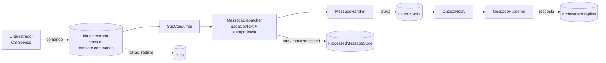

# service-template

Template de microsserviço do Tech Challenge FIAP (Fase 4). NestJS 11 + TypeScript, mensageria por SQS, pronto para participar da saga orquestrada (o orquestrador fica no OS Service).

O template é agnóstico de banco. Outbox e idempotência são portas com implementação em memória; cada serviço implementa o adapter do banco dele (Postgres no Billing, DynamoDB na Execução). Quem usa o template programa contra interfaces e nunca toca no SDK da AWS.

## Arquitetura

Uma fila de comandos por serviço, uma fila de respostas para o orquestrador e uma DLQ por redrive.



Portas (classes abstratas, usadas como token de DI):

| Porta | Para que serve | Implementação do template |
| --- | --- | --- |
| `MessagePublisher` | publicar um envelope em um destino lógico | `SqsMessagePublisher` / `InMemoryMessageBus` |
| `OutboxStore` | transactional outbox (`add`, `pullPending`, `markPublished`) | `InMemoryOutboxStore` |
| `ProcessedMessageStore` | idempotência (`has`, `markProcessed`) | `InMemoryProcessedMessageStore` |
| `MessageHandler` | trata um tipo de mensagem | você implementa |

Fluxo de uma mensagem: o consumer entrega o envelope ao `MessageDispatcher`, que abre o `SagaContext` (sagaId e correlationId, usados pelo logger), ignora mensagens já processadas, chama o handler do `type` e marca como processada. Tipo sem handler: warn e descarte. Erro do handler: a mensagem NÃO é apagada do SQS e, após o `maxReceiveCount`, o redrive manda para a DLQ.

Handlers não publicam direto: gravam no outbox e o `OutboxRelay` publica (at-least-once). Por isso o consumidor sempre deduplica pelo `messageId`.

### Envelope

```ts
{ messageId, type, version, sagaId, correlationId, occurredAt, payload }
```

Crie com `createEnvelope(type, payload, { sagaId, correlationId, version? })`.

### Destinos lógicos

`publish('billing.commands', envelope)` usa o nome lógico. No driver `sqs` ele vira a env `MESSAGING_QUEUE_BILLING_COMMANDS` (maiúsculas, `.` e `-` viram `_`). No driver `memory` o nome lógico é usado direto. A fila de entrada do serviço usa `MESSAGING_INBOUND_QUEUE` (nome lógico) e `MESSAGING_INBOUND_QUEUE_URL`.

## Criando um serviço novo a partir do template

1. No GitHub: **Use this template** e crie o repositório do serviço; clone.
2. `scripts/rename-service.sh <nome-do-servico>` troca `service-template` pelo nome novo em todo o repo (código, k8s, README, workflow).
3. Apague `src/hello` e a linha `HelloModule` do `src/app.module.ts`. É só um exemplo.
4. Implemente `OutboxStore` e `ProcessedMessageStore` para o banco do serviço e troque os providers no `MessagingModule.forRoot()` (`{ provide: OutboxStore, useClass: PostgresOutboxStore }`). Grave `add` do outbox e `markProcessed` na mesma transação dos efeitos do handler sempre que o banco permitir.
5. Escreva os handlers (`implements MessageHandler`) e registre-os no módulo do serviço, explicitamente:

   ```ts
   @Module({ imports: [MessagingModule.forFeature([ChargeHandler])] })
   export class BillingModule {}
   ```

   Opção escolhida: registro explícito via `forFeature`, sem decorator/reflection. Um handler por `type`; duplicado falha no boot.
6. Ajuste os nomes das filas em `.env.example` e `k8s/10-configmap.yaml`.

## Variáveis de ambiente

Ver `.env.example`.

| Env | Default | Descrição |
| --- | --- | --- |
| `PORT` | `3000` | porta HTTP |
| `LOG_LEVEL` | `info` | nível do pino |
| `OTEL_SERVICE_NAME` | `service-template` | nome no log e nos traces |
| `OTEL_EXPORTER_OTLP_ENDPOINT` / `OTEL_TRACES_EXPORTER=console` | desligado | exporter de traces |
| `MESSAGING_DRIVER` | `memory` | `memory` ou `sqs` |
| `MESSAGING_INBOUND_QUEUE` | `service-template.commands` | nome lógico da fila de entrada |
| `MESSAGING_INBOUND_QUEUE_URL` | - | URL da fila de entrada (sqs) |
| `MESSAGING_QUEUE_<NOME>` | - | URL de cada fila de destino (sqs) |
| `OUTBOX_POLL_INTERVAL_MS` | `1000` | intervalo do relay do outbox |
| `AWS_REGION` | - | região do cliente SQS (sqs) |

## Rodando local

```bash
cp .env.example .env   # opcional; o default já é MESSAGING_DRIVER=memory
npm ci
npm run start:dev
curl -X POST localhost:3000/hello -H 'content-type: application/json' -d '{"name":"Mundo"}'
```

- Swagger: `http://localhost:3000/docs` (JSON em `/docs-json`)
- Health: `GET /health/live` e `GET /health/ready` (inclui o driver de mensageria ativo)
- Docker: `docker compose up --build` (só a API, driver memory)

## Testes

```bash
npm run lint
npm run build
npm run test:cov   # unitários, threshold global de 80%
npm run test:e2e   # test/hello.e2e-spec.ts: POST /hello -> hello.replied em orchestrator.replies com o mesmo sagaId
```

Em testes, `InMemoryMessageBus.published` guarda tudo o que foi publicado e `OutboxRelay.flush()` drena o outbox na hora (o timer não precisa rodar).

## Branch e CI

- PR obrigatório na `main`, com 1 aprovação e merge por squash.
- Checks obrigatórios (nomes fixos, não renomeie): `Lint`, `Build`, `Testes`, `Build da imagem Docker`.
- SonarCloud, push no ECR e deploy no EKS entram pelo workflow reutilizável (KAN-87).
- Manifestos em `k8s/`; o namespace `tech-challenge` é placeholder, quem define é a plataforma.
